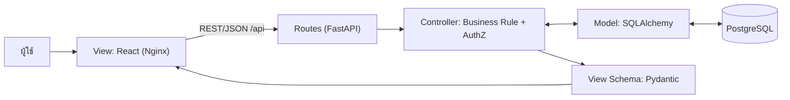

# System Architecture — PetTech: ช่วยน้องหาเลือด

## MVC Mapping

| ชั้น | ที่อยู่ | หน้าที่ |
|---|---|---|
| **Model** | `backend/app/models/` | User, Hero (ฮีโร่ผู้บริจาค), Case (เคสด่วน) |
| **View** | `frontend/src/views/` + `backend/app/views/` | หน้าจอ React และ Pydantic schema ของ API |
| **Controller** | `backend/app/controllers/` | Business Rule, Authorization, Privacy |
| Routes | `backend/app/routes/` | ผูก URL → Controller |

## หน้าจอ ↔ API

| หน้าจอ (ตามแบบ) | Route | API ที่เรียก |
|---|---|---|
| หน้าหลัก (Dashboard, เคสล่าสุด, ขั้นตอน) | `#/` | `GET /stats`, `GET /cases?status=searching&limit=3` |
| เคสด่วน (ตัวกรอง + รายการ) | `#/cases` | `GET /cases`, `POST /cases/{id}/close` |
| ประกาศเคสด่วน | `#/cases/new` | `POST /cases` |
| ลงทะเบียนฮีโร่ | `#/hero` | `POST /heroes` |
| เข้าสู่ระบบ / สมัครสมาชิก | `#/login`, `#/register` | `POST /auth/login`, `POST /auth/register` |
| โปรไฟล์ | `#/profile` | `GET /me`, `/me/cases`, `/me/heroes`, `PATCH /heroes/{id}` |

## Failure Modes / Business Rules

| สถานการณ์ | พฤติกรรมระบบ | ผู้ใช้เห็น |
|---|---|---|
| หมู่เลือดไม่ตรงกับชนิดสัตว์ (เช่น สุนัข + AB) | Controller → 422 | "หมู่เลือดไม่ถูกต้องสำหรับชนิดสัตว์นี้" |
| สุนัข < 20 กก. / แมว < 4 กก. สมัครเป็นฮีโร่ | Controller → 422 | แจ้งเกณฑ์น้ำหนัก |
| เบอร์โทรผิดรูปแบบ | Pydantic → 422 | แจ้งข้อมูลไม่ถูกต้อง |
| ผู้ไม่ได้ล็อกอินเปิดดูเคส/ฮีโร่ | ซ่อน `contact_phone` (Privacy) | ลิงก์ "เข้าสู่ระบบเพื่อดูเบอร์ติดต่อ" |
| ปิดเคสของผู้อื่น | 403 | แจ้งไม่มีสิทธิ์ |
| ปิดเคสซ้ำ | 409 | "เคสนี้ปิดไปแล้ว" |
| Token หมดอายุ | 401 → ล้าง token | กลับหน้าเข้าสู่ระบบ |
| DB ล่ม | `/api/health` → 503, Compose healthcheck | (TODO: หน้าแจ้งระบบขัดข้อง) |

> เกณฑ์น้ำหนักผู้บริจาคเป็นค่าตั้งต้นทั่วไป ทีมควรยืนยันกับสัตวแพทย์/แหล่งอ้างอิงก่อนใช้จริง
