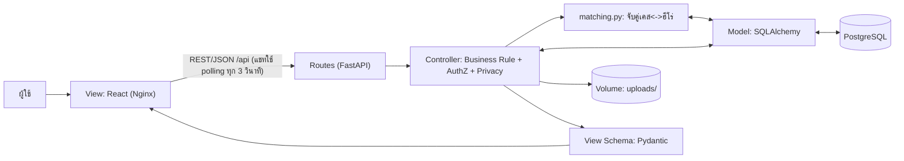
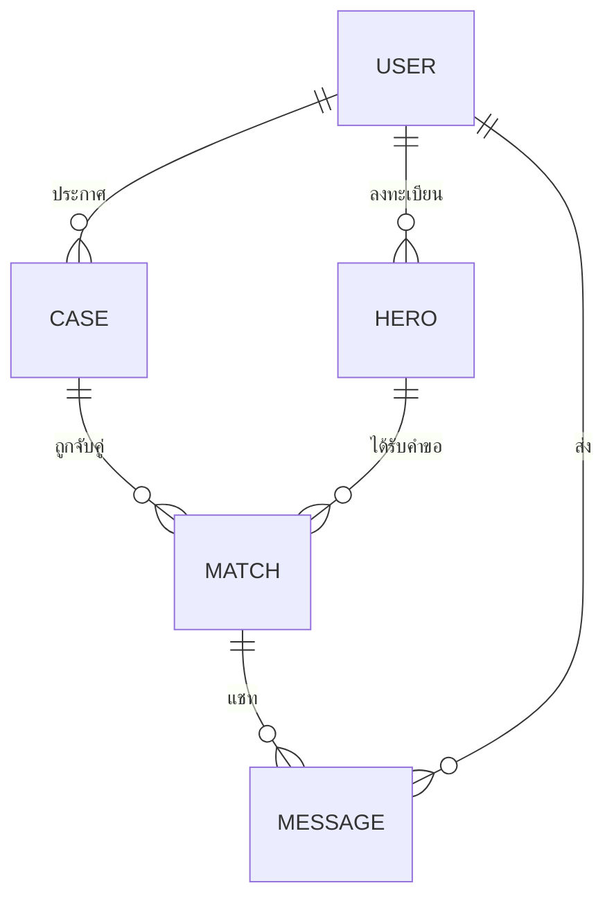
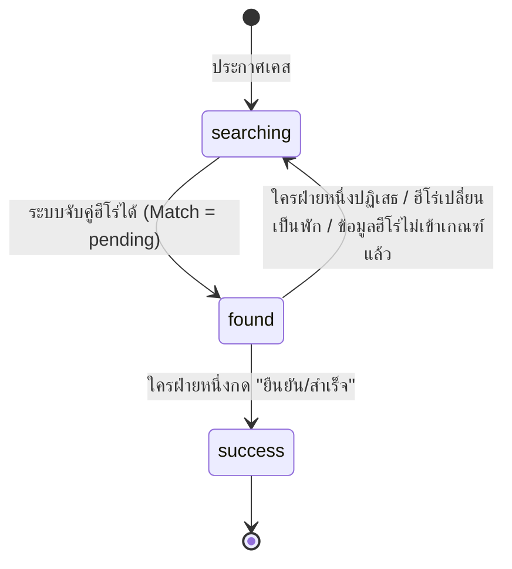

# System Architecture — PetTech: ช่วยน้องหาเลือด

## MVC Mapping

| ชั้น | ที่อยู่ | หน้าที่ |
|---|---|---|
| **Model** | `backend/app/models/` | User, Hero, Case, Match, Message |
| **View** | `frontend/src/views/` + `backend/app/views/` | หน้าจอ React และ Pydantic schema (กำหนดว่าข้อมูลใดส่งออกได้) |
| **Controller** | `backend/app/controllers/` | Business Rule, Authorization, Privacy, การจับคู่ (`matching.py`), อัปโหลดรูป |
| Routes | `backend/app/routes/` | ผูก URL → Controller |

## ข้อมูล (ER)

## วงจรชีวิตของเคสและการจับคู่

**เงื่อนไขที่ฮีโร่ต้องผ่านทั้งหมดจึงถูกจับคู่** (`controllers/matching.py`): สถานะ "พร้อม" · ชนิดเดียวกัน · ไม่ใช่สัตว์ของเจ้าของเคสเอง · หมู่เลือดเข้ากัน (ฮีโร่ "ไม่ทราบ" จับได้ แต่ตัวที่ตรงเป๊ะได้ก่อน) · น้ำหนักถึงเกณฑ์ · สะดวกบริจาคที่โรงพยาบาลของเคส · ไม่เคยถูกปฏิเสธเคสนี้ · ไม่ได้ถือคำขออื่นที่ค้างอยู่ (1 ฮีโร่ : 1 คำขอ)
**ลำดับ:** เคส "ด่วนมาก" ก่อน แล้วตามเวลาประกาศ

**เวลาที่ระบบรันการจับคู่:** ประกาศเคสใหม่ · ลงทะเบียน/แก้ไขฮีโร่ · ฮีโร่เปลี่ยนสถานะ · มีการปฏิเสธ

## หน้าจอ ↔ API

| หน้าจอ | Route | API ที่เรียก |
|---|---|---|
| หน้าหลัก | `#/` | `GET /stats`, `GET /cases?sort=latest&limit=3` |
| เคสด่วน (Filter โรงพยาบาล/ชนิด/กรุ๊ปเลือด/ระดับ) | `#/cases` | `GET /cases`, `GET /meta` |
| เข้าสู่ระบบ / สมัครสมาชิก | `#/login`, `#/register` | `POST /auth/login`, `/auth/register` |
| ลงทะเบียนฮีโร่ / แก้ไขข้อมูลฮีโร่ | `#/hero`, `#/hero/{id}/edit` | `POST /heroes`, `PUT /heroes/{id}`, `GET /me/heroes`, `POST /uploads` |
| ประกาศเคสด่วน | `#/cases/new` | `POST /cases`, `POST /uploads` |
| โปรไฟล์ | `#/profile` | `GET /me/heroes`, `/me/requests`, `/me/cases`, `PATCH /heroes/{id}/status` |
| ติดต่อเคสด่วน / ติดต่อฮีโร่ | `#/matches/{id}` | `GET /matches/{id}`, `POST …/messages`, `…/share-phone`, `…/decline`, `…/confirm` |

หน้าที่ต้องเข้าสู่ระบบ: ลงทะเบียน/แก้ไขฮีโร่, ประกาศเคสด่วน, โปรไฟล์, ติดต่อ (ตาม User Flow) — ผู้ไม่ได้ล็อกอินจะถูกพาไปหน้าเข้าสู่ระบบ แล้วกลับมาหน้าเดิมหลังล็อกอิน

## Privacy และความปลอดภัย

| เรื่อง | การออกแบบ |
|---|---|
| เบอร์โทร | **ไม่อยู่ใน Response ใด ๆ ของคนอื่น** (Pydantic schema ไม่มี field นี้) จะถึงอีกฝ่ายเฉพาะเมื่อกดปุ่ม tel ในแชทของการจับคู่นั้น |
| แชท | เข้าถึงได้เฉพาะ 2 ฝ่ายของการจับคู่ คนนอกได้ 404; เมื่อสิ้นสุด (ปฏิเสธ/ยกเลิก/สำเร็จ) อ่านได้แต่ส่งเพิ่มไม่ได้ (409) |
| อัปโหลดรูป | ต้องล็อกอิน · ≤ 2 MB · ตรวจชนิดจากเนื้อไฟล์จริง (JPG/PNG/WEBP) ไม่เชื่อนามสกุล · ชื่อไฟล์สุ่ม · `photo_url` รับเฉพาะรูปที่อัปโหลดกับระบบนี้ · `nosniff` · กัน path traversal |
| การเข้าสู่ระบบ | ล็อกอินด้วย ชื่อ + อีเมล + รหัสผ่าน (ตามแบบ); ผิดข้อใดก็ตอบข้อความเดียวกัน; รหัสผ่านเก็บแบบ PBKDF2 |
| เจ้าของสิทธิ์ | แก้ไขฮีโร่/เปลี่ยนสถานะได้เฉพาะเจ้าของ; ฮีโร่ไม่ถูกจับกับเคสของเจ้าของเดียวกัน |

## Failure Modes

| สถานการณ์ | พฤติกรรมระบบ | ผู้ใช้เห็น |
|---|---|---|
| ฮีโร่ไม่ผ่านเกณฑ์ (อายุ/น้ำหนัก/วัคซีน/โรคเรื้อรัง/ไม่ติ๊กยืนยัน) | 422 พร้อมรายการทุกข้อ | รายการ "สิ่งที่ไม่ผ่านหรือลืมกรอก" ครบทุกข้อ |
| กรอกไม่ครบ/เบอร์ผิดรูปแบบ | 422 ระบุชื่อช่องเป็นภาษาไทย | ข้อความชื่อช่องที่ผิด |
| รหัสผ่านไม่ได้มาตรฐาน | 422 | แจ้งทุกเงื่อนไขที่ไม่ผ่าน |
| อีเมลซ้ำ | 409 | "อีเมลนี้ถูกใช้แล้ว" |
| ปฏิเสธ/ยืนยัน/ส่งข้อความหลังสิ้นสุด | 409 | "การติดต่อนี้สิ้นสุดแล้ว" |
| ไม่มีฮีโร่เข้าเกณฑ์ | เคสคงสถานะ "กำลังตามหา" และถูกจับอัตโนมัติเมื่อมีฮีโร่ใหม่/ฮีโร่กลับมาพร้อม | แสดงในรายการเคสด่วน |
| Token หมดอายุ | 401 → ล้าง token | กลับหน้าเข้าสู่ระบบ |
| DB ล่ม | `/api/health` → 503, Compose healthcheck | (TODO: หน้าแจ้งระบบขัดข้อง) |

## ข้อจำกัดที่ทราบ (บอกผู้ตรวจได้ตรง ๆ)

- จับคู่ชื่อโรงพยาบาลแบบตรงตัว (ไม่สนช่องว่างซ้ำ/ตัวพิมพ์) — มีรายการแนะนำจากข้อมูลในระบบเพื่อลดการสะกดต่างกัน แต่ยังไม่มีตารางโรงพยาบาลกลาง
- การจับคู่ทำใน Request เดียวกับที่เกิดเหตุการณ์ ถ้ามี 2 Request พร้อมกันมากอาจจับฮีโร่ซ้ำได้ (ควรเพิ่ม DB lock/unique constraint หรือ Worker คิวหากใช้งานจริง)
- แชทใช้ polling ทุก 3 วินาที ไม่ใช่ WebSocket
- `create_all` ไม่แก้ตารางเดิม — เปลี่ยน Model แล้วต้อง `docker compose down -v` (หรือเปลี่ยนเป็น Alembic)
- เกณฑ์การบริจาคแปลงมาจากแบบหน้าจอของทีม ควรอ้างอิงแหล่งที่มาทางสัตวแพทย์ก่อนใช้จริง (`controllers/rules.py`, `frontend/src/lib/criteria.js`)
